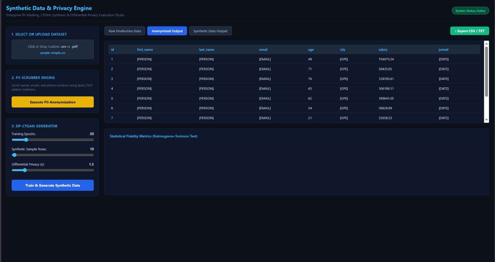

# 🛡️ Synthetic Data & Privacy Engine

An enterprise-grade FastAPI application designed for automated PII scrubbing (SpaCy NLP + Regex), DP-CTGAN synthetic data generation (PyTorch), and statistical distribution fidelity evaluation (SciPy Kolmogorov-Smirnov test).

---

## 🖥️ Dashboard Preview



---

## ✨ Key Features

- **Hybrid PII Scrubber Engine:** Strips direct and soft identifiers (`[PERSON]`, `[EMAIL]`, `[PHONE]`, `[GPE]`, `[DATE]`) using deterministic regex matchers and SpaCy Named Entity Recognition (NER).
- **Column-Aware Sanitization:** Preserves exact column structure while scrubbing sensitive text fields without distorting numerical features.
- **DP-CTGAN Generator:** Trains deep learning models (PyTorch CTGAN) to produce 100% artificial tabular records under configurable Differential Privacy ($\epsilon$) limits.
- **Statistical Fidelity Metrics:** Evaluates synthetic data distribution accuracy against raw production data using the Kolmogorov-Smirnov ($p$-value) test.
- **Interactive Web Studio:** Dark-mode FastAPI interface with drag-and-drop `.csv` and `.pdf` file uploads and one-click export features.

---

## 🛠️ Tech Stack

- **Backend:** FastAPI, Uvicorn, Python 3.10+
- **Machine Learning & NLP:** PyTorch, CTGAN, SpaCy (`en_core_web_sm`)
- **Data & Statistics:** Pandas, NumPy, SciPy (KS-Test)
- **Frontend:** HTML5, CSS3, JavaScript (ES6), Chart.js
- **DevOps / IaC:** Docker, Terraform (AWS deployment configuration)

---

## 🚀 Quickstart Guide

### 1. Clone the Repository & Setup Virtual Environment
```powershell
git clone [https://github.com/YOUR_GITHUB_USERNAME/synthetic-data-engine.git](https://github.com/YOUR_GITHUB_USERNAME/synthetic-data-engine.git)
cd synthetic-data-engine
python -m venv venv
.\venv\Scripts\Activate.ps1